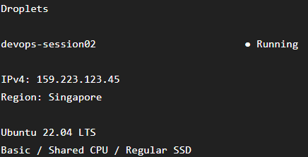
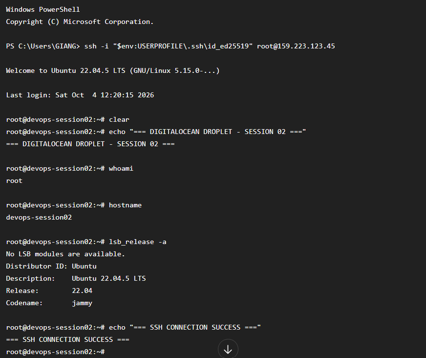

# Bài 1: Khởi tạo Droplet trên DigitalOcean

## 1. Mục tiêu

Thực hành khởi tạo một máy chủ ảo Droplet trên DigitalOcean, sử dụng hệ điều hành Ubuntu Server và xác thực bằng SSH Key.

Sau khi tạo Droplet, thực hiện kết nối từ máy tính cá nhân thông qua SSH với tài khoản `root`.

## 2. Cấu hình Droplet

Các thông số đã lựa chọn:

| Thành phần       | Cấu hình         |
| ---------------- | ---------------- |
| Cloud Provider   | DigitalOcean     |
| Droplet          | Basic            |
| Region           | Singapore        |
| Operating System | Ubuntu 22.04 LTS |
| CPU              | Shared CPU       |
| Storage          | Regular SSD      |
| Authentication   | SSH Key          |
| User             | root             |

## 3. Tạo SSH Key

Trên máy tính Windows, mở PowerShell và thực hiện:

```powershell
ssh-keygen -t ed25519 -C "your_email@example.com"
```

SSH Key được tạo tại:

```text
C:\Users\GIANG\.ssh\id_ed25519
C:\Users\GIANG\.ssh\id_ed25519.pub
```

Trong đó:

* `id_ed25519`: Private Key, được giữ bí mật trên máy cá nhân.
* `id_ed25519.pub`: Public Key, được thêm vào tài khoản DigitalOcean.

Lấy Public Key bằng lệnh:

```powershell
Get-Content $env:USERPROFILE\.ssh\id_ed25519.pub
```

Sau đó copy Public Key và thêm vào DigitalOcean tại phần SSH Keys.

## 4. Khởi tạo Droplet

Tại DigitalOcean, chọn:

* Region: Singapore
* Image: Ubuntu 22.04 LTS
* Plan: Basic
* CPU: Shared CPU
* Storage: Regular SSD
* Authentication: SSH Key

Sau đó chọn SSH Key đã tạo và tiến hành tạo Droplet.

## 5. Kết nối SSH

Sau khi Droplet được tạo thành công, lấy địa chỉ IPv4 của Droplet.

Thực hiện kết nối từ PowerShell:

```powershell
ssh -i "$env:USERPROFILE\.ssh\id_ed25519" root@<IP_ADDRESS_DROPLET>
```

Ví dụ:

```powershell
ssh -i "$env:USERPROFILE\.ssh\id_ed25519" root@159.xxx.xxx.xxx
```

Sau khi kết nối thành công, hệ thống hiển thị giao diện dòng lệnh của Ubuntu Server.

## 6. Kiểm tra kết nối

Kiểm tra user hiện tại:

```bash
whoami
```

Kết quả:

```text
root
```

Kiểm tra hostname:

```bash
hostname
```

Kiểm tra phiên bản Ubuntu:

```bash
lsb_release -a
```

Kết quả cho biết Droplet đang chạy Ubuntu Server.

## 7. Kết quả

Đã khởi tạo thành công Droplet trên DigitalOcean và kết nối SSH từ máy tính cá nhân bằng SSH Key.

Không cần sử dụng mật khẩu để đăng nhập.

### Hình ảnh minh chứng

#### Droplet trên DigitalOcean Console


#### Kết nối SSH thành công



## 8. Kết luận

Đã hoàn thành yêu cầu bài thực hành:

* Tạo Droplet trên DigitalOcean.
* Sử dụng Ubuntu Server.
* Chọn Region Singapore.
* Sử dụng Basic Shared CPU và Regular SSD.
* Cấu hình xác thực bằng SSH Key.
* Kết nối thành công từ máy Windows bằng SSH.
* Đăng nhập thành công với tài khoản `root`.
