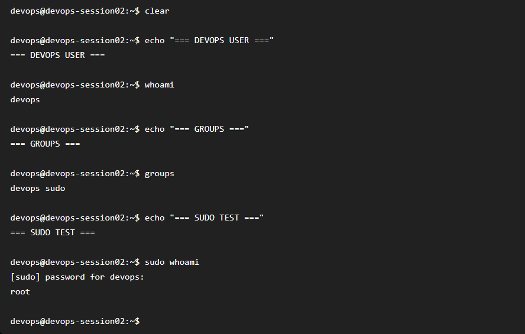

# Bài 2: Khởi tạo User thường và thiết lập đặc quyền quản trị

## 1. Mục tiêu

Tạo user thường `devops` trên Ubuntu Server và cấp quyền quản trị thông qua nhóm `sudo`.

Sau khi cấu hình, user `devops` có thể đăng nhập bằng SSH Key và thực hiện các lệnh quản trị thông qua `sudo`.

## 2. Tạo user devops

Đăng nhập vào Droplet bằng tài khoản `root` và thực hiện:

```bash
adduser devops
```

Sau đó thiết lập mật khẩu cho user `devops`.

## 3. Thêm devops vào nhóm sudo

```bash
usermod -aG sudo devops
```

Kiểm tra:

```bash
groups devops
```

Kết quả:

```text
devops : devops sudo
```

Điều này cho biết user `devops` đã thuộc nhóm `sudo`.

## 4. Sao chép SSH Key

Sao chép thư mục SSH của root sang user `devops`:

```bash
rsync --archive --chown=devops:devops /root/.ssh /home/devops/
```

Kiểm tra:

```bash
ls -la /home/devops/.ssh
```

## 5. Thiết lập quyền cho SSH

Thực hiện:

```bash
chown -R devops:devops /home/devops/.ssh
chmod 700 /home/devops/.ssh
chmod 600 /home/devops/.ssh/authorized_keys
```

Kiểm tra:

```bash
ls -ld /home/devops/.ssh
ls -l /home/devops/.ssh/authorized_keys
```

Kết quả cho thấy thư mục `.ssh` thuộc user `devops` và có permission `700`, file `authorized_keys` có permission `600`.

## 6. Kiểm tra đăng nhập SSH

Từ máy tính cá nhân, thực hiện:

```powershell
ssh -i "$env:USERPROFILE\.ssh\id_ed25519" devops@<IP_ADDRESS_DROPLET>
```

Đăng nhập thành công với user:

```bash
whoami
```

Kết quả:

```text
devops
```

## 7. Kiểm tra quyền sudo

Thực hiện:

```bash
sudo whoami
```

Sau khi nhập mật khẩu của user `devops`, kết quả:

```text
root
```

Điều này chứng minh user `devops` đã được cấp quyền quản trị thông qua nhóm `sudo`.

## 8. Kết quả

Đã hoàn thành các yêu cầu:

* Tạo user `devops`.
* Thêm `devops` vào nhóm `sudo`.
* Sao chép SSH Key từ root sang `devops`.
* Thiết lập permission cho thư mục `.ssh`.
* Thiết lập permission cho `authorized_keys`.
* Đăng nhập thành công bằng SSH Key với user `devops`.
* Thực hiện thành công `sudo whoami`.

## 9. Hình ảnh minh chứng

### SSH đăng nhập bằng user devops



### Kết quả sudo

Kết quả `sudo whoami` trả về:

```text
root
```
