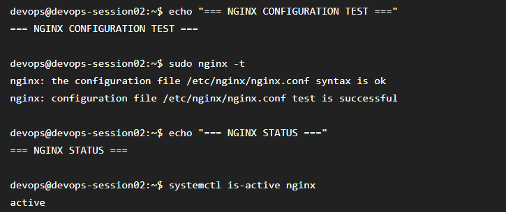
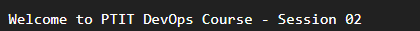

# Bài 3: Cài đặt Nginx và cấu hình Website tĩnh

## 1. Mục tiêu

Cài đặt Nginx trên Ubuntu Server và cấu hình một website tĩnh sử dụng Server Block riêng.

Website hiển thị nội dung:

> Welcome to PTIT DevOps Course - Session 02

## 2. Cài đặt Nginx

Cập nhật package:

```bash
sudo apt update
```

Cài đặt Nginx:

```bash
sudo apt install nginx -y
```

Kiểm tra trạng thái:

```bash
sudo systemctl status nginx
```

Nginx hoạt động với trạng thái:

```text
Active: active (running)
```

## 3. Tạo thư mục website

Tạo thư mục:

```bash
sudo mkdir -p /var/www/ptit-web/html
```

Tạo file:

```bash
sudo nano /var/www/ptit-web/html/index.html
```

Nội dung file:

```html
<!DOCTYPE html>
<html lang="en">
<head>
    <meta charset="UTF-8">
    <title>PTIT DevOps Course</title>
</head>
<body>
    <h1>Welcome to PTIT DevOps Course - Session 02</h1>
</body>
</html>
```

## 4. Cấu hình Server Block

Tạo file:

```bash
sudo nano /etc/nginx/sites-available/ptit-web.conf
```

Cấu hình:

```nginx
server {
    listen 80;
    listen [::]:80;

    server_name _;

    root /var/www/ptit-web/html;
    index index.html;

    location / {
        try_files $uri $uri/ =404;
    }
}
```

## 5. Kích hoạt Server Block

Tạo symbolic link:

```bash
sudo ln -s /etc/nginx/sites-available/ptit-web.conf /etc/nginx/sites-enabled/ptit-web.conf
```

Tắt cấu hình mặc định:

```bash
sudo rm /etc/nginx/sites-enabled/default
```

## 6. Kiểm tra cấu hình

Chạy:

```bash
sudo nginx -t
```

Kết quả:

```text
syntax is ok
test is successful
```

Sau đó reload Nginx:

```bash
sudo systemctl reload nginx
```

## 7. Kiểm tra website

Truy cập từ trình duyệt:

```text
http://<IP_ADDRESS_DROPLET>
```

Website hiển thị:

```text
Welcome to PTIT DevOps Course - Session 02
```

## 8. Kết quả

Đã hoàn thành:

* Cài đặt Nginx.
* Tạo thư mục `/var/www/ptit-web/html/`.
* Tạo file `index.html`.
* Tạo Server Block `ptit-web.conf`.
* Kích hoạt Server Block bằng symbolic link.
* Hủy kích hoạt website mặc định.
* Kiểm tra cấu hình bằng `nginx -t`.
* Reload Nginx.
* Truy cập thành công website từ Internet.

## 9. Hình ảnh minh chứng

### Kiểm tra Nginx



### Website PTIT


