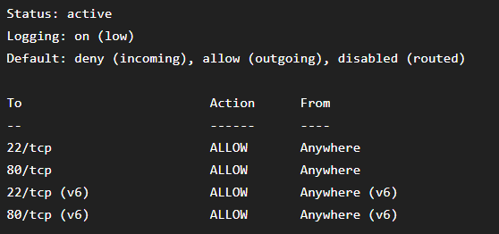
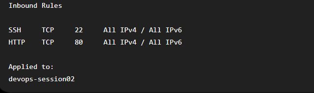
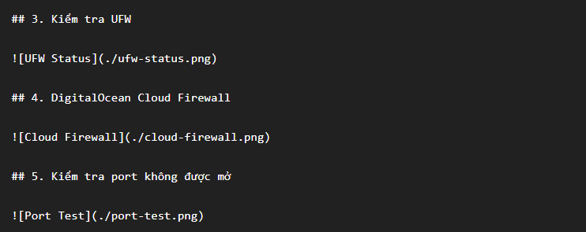

# Bài 4: Cấu hình tường lửa bảo vệ máy chủ

## 1. Mục tiêu

Thiết lập tường lửa hai lớp cho Droplet:

* UFW trên Ubuntu Server.
* DigitalOcean Cloud Firewall.

Chỉ cho phép lưu lượng SSH trên port 22 và HTTP trên port 80.

## 2. Cấu hình UFW

Thiết lập mặc định chặn kết nối đi vào:

```bash
sudo ufw default deny incoming
```

Cho phép kết nối đi ra:

```bash
sudo ufw default allow outgoing
```

Cho phép SSH:

```bash
sudo ufw allow 22/tcp
```

Cho phép HTTP:

```bash
sudo ufw allow 80/tcp
```

Kích hoạt UFW:

```bash
sudo ufw enable
```

## 3. Kiểm tra UFW

Thực hiện:

```bash
sudo ufw status verbose
```

Kết quả cho thấy:

```text
Status: active
Default: deny (incoming), allow (outgoing)

22/tcp    ALLOW    Anywhere
80/tcp    ALLOW    Anywhere
```



## 4. Cấu hình DigitalOcean Cloud Firewall

Tạo Cloud Firewall với tên:

```text
ptit-devops-firewall
```

Inbound Rules:

| Service | Protocol | Port | Source   |
| ------- | -------- | ---: | -------- |
| SSH     | TCP      |   22 | Anywhere |
| HTTP    | TCP      |   80 | Anywhere |

Cloud Firewall được áp dụng cho Droplet `devops-session02`.



## 5. Kiểm tra SSH

Từ máy tính cá nhân:

```powershell
ssh -i "$env:USERPROFILE\.ssh\id_ed25519" devops@<IP_ADDRESS_DROPLET>
```

Kết nối SSH thành công.

## 6. Kiểm tra HTTP

Truy cập:

```text
http://<IP_ADDRESS_DROPLET>
```

Website hiển thị:

```text
Welcome to PTIT DevOps Course - Session 02
```

## 7. Kiểm tra port không được mở

Kiểm tra port 8080 từ máy cá nhân:

```powershell
Test-NetConnection <IP_ADDRESS_DROPLET> -Port 8080
```

Kết quả:

```text
TcpTestSucceeded : False
```

Điều này cho thấy port 8080 không được phép truy cập từ bên ngoài.



## 8. Kết luận

Đã hoàn thành cấu hình firewall hai lớp cho Droplet:

* UFW được kích hoạt.
* Default incoming policy là deny.
* Default outgoing policy là allow.
* SSH port 22 được phép.
* HTTP port 80 được phép.
* DigitalOcean Cloud Firewall được cấu hình.
* Droplet được gán vào Cloud Firewall.
* SSH và HTTP vẫn hoạt động.
* Các port không được cho phép bị chặn.
